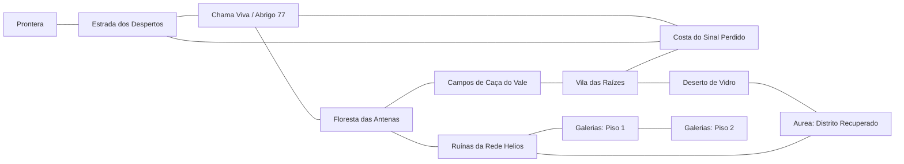

# Rotas compartilhadas de Éridan

Dez regiões nativas novas conectam Chama Viva, Prontera, Vila das Raízes e o distrito recuperado de Aurea. Cada passagem tem volta, placa de destino e chegada afastada do portal. As quatro versões de reconstrução da Chama Viva compartilham as mesmas rotas; o retorno acompanha a etapa atual da comunidade.

Saia pelo portão sul da Chama Viva para a Estrada dos Despertos, pelo norte para a floresta, pelo leste para a costa ou pelo oeste para a ligação lateral da estrada. Os marcos e placas explicam os destinos dentro do jogo. A entrada das galerias fica no bunker das Ruínas da Rede Helios.

As áreas são públicas e compartilhadas. Jogadores podem formar grupo pela janela **Grupo**, combinar uma rota e atravessar os mesmos portais. Ninguém precisa aceitar uma missão individual para liberar os caminhos. As galerias também são compartilhadas; chefes exclusivos e instâncias privadas não fazem parte desta integração.

| Região | Faixa recomendada | Função |
|---|---|---|
| Estrada dos Despertos | 10–15 | Caminho inicial e caça leve |
| Floresta das Antenas | 10–20 | Trilhas e lagoas entre antenas antigas |
| Campos de Caça do Vale | 15–30 | Clareiras para combate em grupo |
| Vila das Raízes | Segura | Descanso e ponto de retorno |
| Costa do Sinal Perdido | 15–30 | Oceano, falésias e ferrovia abandonada |
| Deserto de Vidro | 20–40 | Dunas, ruínas e coletores solares |
| Aurea — Distrito Recuperado | Segura | Comunidade nas ruínas da antiga capital |
| Ruínas da Rede Helios | 25–45 | Exploração e entrada das galerias |
| Galerias do Núcleo — Piso 1 | 30–50 | Masmorra compartilhada |
| Galerias do Núcleo — Piso 2 | 45–60 | Cristais do Éter e combate mais difícil |

Os nomes de criaturas evocam Éridan, usando sprites e atributos nativos existentes. As faixas são recomendações, sem bloqueio por nível. Descanso e salvamento ficam nas comunidades seguras. Contas e progresso anteriores são preservados.

Os limites caminháveis ficam antes das bordas físicas. Muralhas, falésias, dunas, mata e paredes subterrâneas delimitam as regiões; água e construções bloqueadas têm colisão correspondente. A Chama Viva ganhou cenário externo e muralhas nos lados restantes, preservando as coordenadas das missões existentes. Quem reconectar em uma célula agora bloqueada retorna à praça.

Para editar, abra `content/eridan/data/er_mata.rsw` ou outro RSW no BrowEdit. Salve **RSW, GND e GAT** e execute `scripts/EditarVilaWindows.cmd -Aplicar`. O validador verifica destinos, NPCs, chegadas e a conectividade completa antes de publicar. `content/eridan/world.json` descreve as regiões e rotas; `rathena/eridan-world.txt` executa as passagens, NPCs e caças reais.

`scripts/build_eridan_world.mjs` e `scripts/prepare_world_materials.py` reproduzem os arquivos originais. `scripts/build_world_minimaps.py` atualiza os minimapas a partir dos terrenos e colisões físicos. Gerar novamente substitui edições manuais: faça backup antes. Regenerar não acontece durante a inicialização do servidor.

Verificação: `node --test client/ragnarok/tests/world.test.mjs` e `node scripts/test_world_loaders.mjs` (45 verificações usando os loaders reais do roBrowser). O servidor registra as mesmas células GAT no cache nativo; o cliente utiliza os arquivos físicos novos. Referência: [comandos de script do rAthena](https://github.com/rathena/rathena/blob/master/doc/script_commands.txt).
